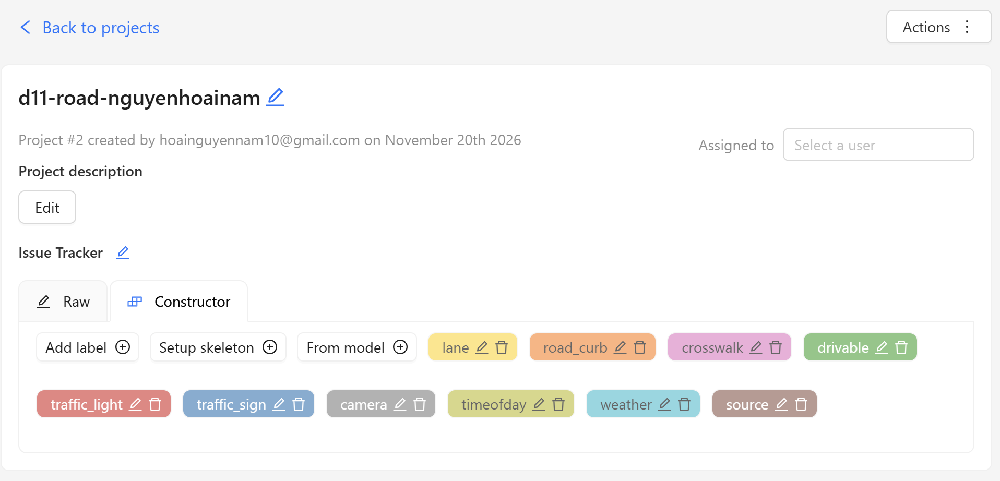
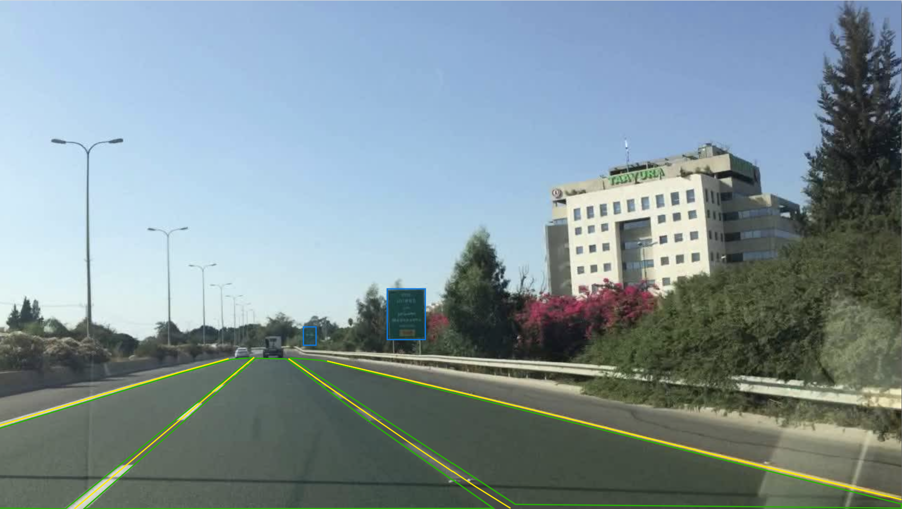
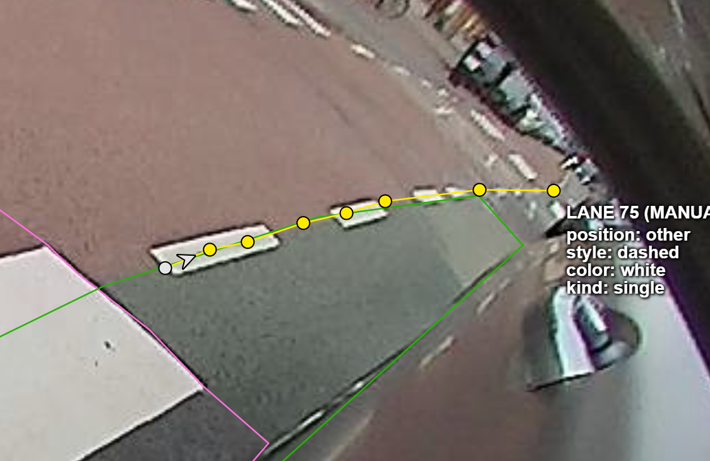
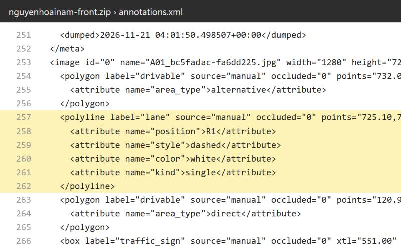

# Báo cáo cá nhân — Ngày 11
Họ tên: Nguyễn Hoài Nam               Mã học viên: 2A202603186  
Phiên bản CVAT (Help → About): CVAT v2.81.0 (CVAT của lớp, chạy local)  
Guideline: Road v1.0    Lần nộp (`revision` trong manifest): 2 (bản 1 cất ở `r1/`)  
Thời điểm export (ngày giờ trên CVAT): 21/11/2026 11:42 (UTC+7; lần 1: 10:15)    Số lần nộp lại sau Rework: 1  

## 1. Kiểm project
| Mục | Đúng như guideline Road v1.0? | Ghi chú |
| --- | --- | --- |
| 6 label, đúng kiểu | Đúng | lane, road_curb (polyline); crosswalk, drivable (polygon); traffic_light, traffic_sign (rectangle). Labels trong file export khớp từng ký tự với `python -m road_lab.taxonomy` |
| Thuộc tính và giá trị | Đúng | Đủ giá trị, gồm cả `overcast` của tag weather; `edge_zone` là checkbox |
| 4 tag ảnh | Đúng | camera, timeofday, weather, source; mỗi label kiểu Tag có một thuộc tính select `value` |
Cách kết thúc polyline trên bản CVAT này: bấm phím **N** sau điểm cuối (hoặc chuột phải / nút Done trên thanh công cụ).  
Cách đặt tag ảnh trên bản CVAT này: chọn công cụ **Tag** ở thanh bên trái, chọn label (camera trước), bấm Tag; sau đó mở **Details** trong bảng Objects để chọn `value`, vì CVAT tự điền giá trị đầu danh sách.  

## 2. Số lượng đã gán
| Task | Ảnh | lane | road_curb | crosswalk | drivable | traffic_light | traffic_sign |
| --- | ---: | ---: | ---: | ---: | ---: | ---: | ---: |
| front | 12 | 32 | 4 | 5 | 24 | 27 | 27 |
| front-extra (đã làm 4 / 4) | 4 | 11 | 2 | 3 | 8 | 9 | 11 |
| fisheye | 8 | 5 | 10 | 8 | 10 | 7 | 10 |
| fisheye-extra (đã làm 4 / 4) | 4 | 1 | 4 | 4 | 4 | 0 | 0 |

## 3. Bảng ca khó
| Ảnh | Nhãn | Phân vân giữa | Đã chọn | Lý do |
| --- | --- | --- | --- | --- |
| A04, A11, A14 (vàng đôi), A09 (trắng đôi) | lane `kind=double` | Vẽ 1 polyline giữa hai nét hay trên tâm một nét | 1 polyline ở giữa hai nét | Guideline coi vạch đôi là một vạch có `kind=double`; vẽ hai đường bị lint báo trùng position (QC1-05) |
| A12 | lane L1/R1 | Xe đang đè lên vạch đứt giữa: làn trái hay làn phải | Làn trái là `direct`, vạch đứt giữa là R1 | Polygon `direct` đặt ở làn trái; đầu xe lệch trái so với vạch |
| A05 | lane | Vẽ thêm vạch hay để trống | Để trống (không có L1/R1) | Đường không có vạch sơn; lint báo QC1-02, coach đã xác nhận miễn |
| A09, A14 | lane R1 | Mép phải là lane hay road_curb | road_curb | Mép phải không có vạch sơn; QC1-02 "chưa có R1" được coach xác nhận miễn |
| B03, B04 (fisheye_rear) | lane position | Đặt L/R theo trái/phải của ảnh hay theo hướng xe | Theo hướng xe (bên phải ảnh = bên trái xe) | Guideline định nghĩa position theo làn đang đi, không theo khung ảnh |
| A06, A12, A14, A16 | traffic_light pedestrian | Đèn đi bộ hình người trắng/cam: chọn màu nào | Trắng (đi) → green, cam (dừng) → red | Bảng màu chỉ có red/yellow/green/off/unknown; chọn theo ý nghĩa tín hiệu |
| A08 | traffic_sign | "PASSENGER CARS ONLY" là biển phụ hay biển cấm | supplementary | Tấm chữ đi kèm biển chỉ dẫn lớn, không tự đứng một mình |
| A03, A11, A16, B05, B06 | tag weather | clear hay overcast | clear | Trời có mây nhưng còn nắng / không thấy trời; mặt đường khô |
| B03 | road_curb / drivable | Mép vỉa đặt ở mép đảo hay mép nhựa (giữa có rãnh gạch) | Curb ở mép đảo | Ranh giới thật giữa đường và vỉa là mặt đứng của đảo |
| B11 | lane | Gán vạch ô đỗ / vạch vàng là lane hay bỏ | Bỏ, chỉ gán drivable | Guideline mục 4: vạch ô đỗ không gán lane |
| A11 | lane vạch vàng đôi | Một polyline `kind=double` ở giữa hai nét, hay hai polyline (mỗi nét một đường) | Giữ hai polyline (L1 và L2) | Quan điểm của tôi: vạch đôi có hai nét nên vẽ hai đường. Phiếu QC 1 ghi đây là lỗi QC1-03 nặng; coach xác nhận cách làm của tôi |
| A07 | traffic_sign | Biển thoi cam ở mép trái (cao ≈ 19 px) có gán không | Chưa gán | Biển mờ, không xác định được loại biển; coach xác nhận không bắt buộc gán |
| B07 | drivable | Phần mặt đường ở góc trái dưới là làn xe đạp hay mặt đường | Giữ trong drivable | Theo ngữ cảnh ảnh tôi coi đó là mặt đường; guideline không nói rõ về làn xe đạp; coach xác nhận cách làm của tôi |

## 4. Phiếu QC 1 nhận được
Bạn kiểm lô của tôi: Đinh Đức Hiếu (`dinhduchieu`)  Quyết định nhận được: **Rework** (1 lỗi nặng; lỗi chính 7 / 77 nhãn = 9,1 %). Ảnh kiểm: A03, A04, A07, A11, B03, B07; ảnh "không lỗi": B03.  
Đã nộp lại: `revision` 2 (chỉ export lại task front; task front-extra, fisheye, fisheye-extra không đổi).  
| Mã lỗi | Số lỗi | Đồng ý? | Đã sửa? |
| --- | ---: | --- | --- |
| QC1-03 (nặng) — A11: nét ngoài vạch vàng đôi gán thành L2 riêng | 1 | Không — tôi cho rằng vạch đôi có hai nét nên vẽ hai polyline; coach xác nhận cách làm của tôi | Không cần |
| QC1-04 (chính) — A11: L1 không ở giữa hai nét vạch đôi | 1 | Không — cùng lý do trên; coach xác nhận | Không cần |
| QC1-08 (chính) — A03, A04: thiếu đèn xanh | 2 | Đồng ý | Có — A03 thêm 2 hộp đèn, A04 thêm 1 hộp đèn |
| QC1-09 (chính) — A07: biển nhìn mặt sau gán front/prohibitory | 1 | Đồng ý | Có — đổi thành `facing = back`, `group = other` |
| QC1-10 (chính) — A07: thiếu biển thoi cam | 1 | Không — biển mờ, không xác định được loại; coach xác nhận không bắt buộc gán | Không cần |
| QC1-07 (chính) — A07: drivable khoét quanh xe phía trước | 1 | Đồng ý | Có — kéo `direct` qua xe tới cuối làn |
| QC1-07 (chính) — B07: drivable tràn sang làn xe đạp | 1 | Không — theo ngữ cảnh ảnh vùng đó là mặt đường; coach xác nhận | Không cần |
| QC1-12 (nhẹ) — manifest không khớp file | 1 | Đồng ý — đã gửi nhầm bản export theo job (12 + 8 ảnh); bản nộp lại gửi đúng cặp zip + manifest revision 2 (16 + 12 ảnh, sha256 khớp) | Có |

## 5. Kiểm file export
Kết quả `road_check lint nguyenhoainam-front.zip nguyenhoainam-fisheye.zip` (revision 2): 28 ảnh, 7 cảnh báo — 4 QC1-02 nặng ở A05 ×2, A09, A14 (ảnh không có vạch, coach đã xác nhận miễn) và 3 QC1-08 nhẹ ở A03, A04, A08 (hộp đèn < 8 px, không bắt buộc). `road_check selftest`: SELFTEST PASS; `pytest`: 31 passed. Manifest revision 2: `contains_images = false` cho cả hai file, 16/16 và 12/12 ảnh đủ bốn tag.

| File | Mở lại được? | Số shape ảnh 1 (job / file) | Số shape ảnh 2 (job / file) | Tag camera có trong XML? |
| --- | --- | --- | --- | --- |
| nguyenhoainam-front.zip | Có (lint đọc được 16 ảnh) | A01: 9 / 9 | A02: 7 / 7 | Có (`front` ở cả 16 ảnh) |
| nguyenhoainam-fisheye.zip | Có (lint đọc được 12 ảnh) | B01: 4 / 4 | B02: 8 / 8 | Có (fisheye_front/rear/left/right đúng theo FV/RV/MVL/MVR) |

## 6. Ảnh chụp màn hình
1. Tab Labels của project.

   

2. Một ảnh camera trước đã gán đủ (làn, vùng lái, đèn/biển) — A01.

   

3. Một ảnh fisheye đã gán, phóng to đoạn polyline cong — lane `other` dashed trên camera phải.

   

4. Một đoạn XML có <polyline label="lane"> (`annotations.xml` trong `nguyenhoainam-front.zip`, ảnh A01).

   

## 7. Tự đánh giá
Lỗi bạn mắc nhiều nhất hôm nay (theo mã QC1-xx), và cách tránh ở Ngày 20:  
**QC1-08** — sót đèn xanh (A03, A04) và để màu mặc định `red` khi thêm đèn. Ngày 20: mở Details kiểm `color` ngay sau mỗi box, phóng to vùng cột đèn để không sót đèn ≥ 8 px.  

Nhãn của bạn đi vào model ở đâu? Chọn một lỗi đã sửa và nói nó làm model học sai thế nào:  
`drivable` là mask cho model phân đoạn vùng lái; `lane` là đích cho model phát hiện làn; đèn/biển là đích cho model phát hiện và phân loại. Lỗi đã sửa: **A07 — drivable khoét quanh xe phía trước**. Model sẽ học "mặt đường sau xe không lái được", nên mỗi khi có xe phía trước, vùng lái dự đoán bị cắt cụt ở đuôi xe và làn trông như kết thúc sớm.  

## 8. (Tùy chọn, buffer) Từ polyline đến đích row-anchor
Vạch R1 (trắng, đứt) ảnh A01; số liệu từ `python -m road_lab.rowanchor <file>-front.zip --image A01`.

| y | 720 | 680 | 640 | 600 | 560 |
| --- | ---: | ---: | ---: | ---: | ---: |
| x của chúng tôi | không có làn | 662.8 | 603.0 | 544.6 | 486.4 |
| x của bạn kia (dinhduchieu) | không có làn | 652.7 | 600.0 | 542.5 | 483.0 |

Trả lời 3 câu:

1. Năm số x đó chính là đích mà một model row-anchor học cho vạch này. Nếu bạn dừng polyline sớm 40 px, hàng nào đổi thành "không có làn"?  
   R1 của tôi đi từ y = 719 lên y = 507. Dừng sớm 40 px thì điểm cuối ở y ≈ 547, vẫn qua hàng 560, nên cả năm hàng giữ nguyên; chỉ các hàng xa hơn (ví dụ 520) mất làn. Với polyline của bạn kia (điểm cuối y = 525), dừng sớm 40 px sẽ làm hàng 560 thành "không có làn".
2. So với bạn được kiểm (cùng ảnh): ở hàng 720 và hàng 560, hai bạn lệch nhau bao nhiêu pixel? Lệch ở hàng nào ảnh hưởng LKA nhiều hơn (slide 25)?  
   Hàng 720 không so được: cả hai đều "không có làn" (của tôi bắt đầu ở y = 719, của bạn kia ở y = 682). Hàng gần nhất so được là 680: lệch 10,1 px; hàng 560: lệch 3,4 px. Lệch ở hàng gần xe ảnh hưởng LKA nhiều hơn, vì vị trí ngang của xe trong làn được tính chủ yếu từ phần vạch sát xe.
3. Nếu polyline vẽ từ xa về gần (ngược quy tắc 2), cách tính trên có đổi không? Script nào sẽ gặp khó?  
   Với vạch không vòng lại thì số x không đổi: `x_at_y` nội suy theo cặp điểm kẹp hàng y, không phụ thuộc thứ tự (đã thử đảo thứ tự điểm R1, kết quả giống hệt). Script gặp khó là những chỗ coi điểm đầu là điểm gần xe: `road_check` báo QC1-04 "điểm đầu cao hơn điểm cuối" và chấm sai điểm đầu/cuối, `rowanchor` in cảnh báo vẽ từ xa về gần; với vạch cong cắt một hàng hai lần, giá trị lấy được còn phụ thuộc thứ tự điểm.
